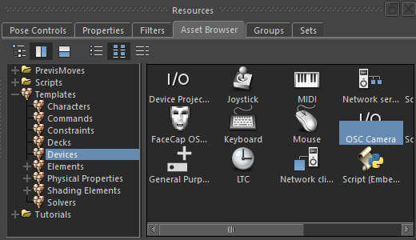
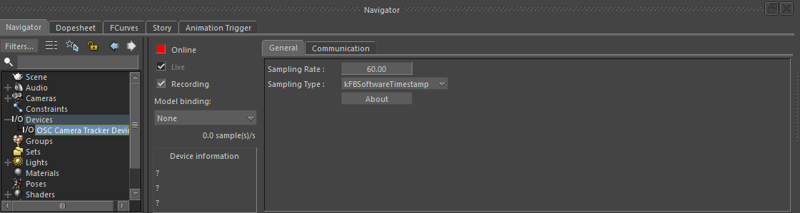
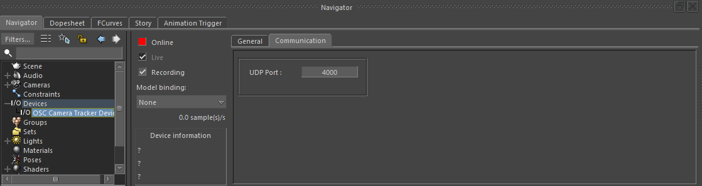
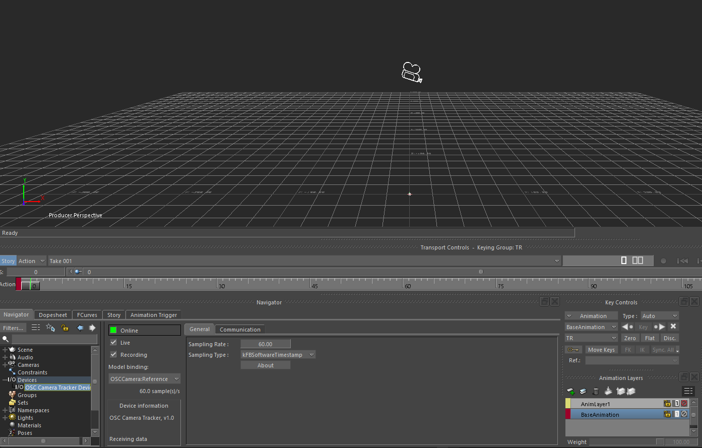
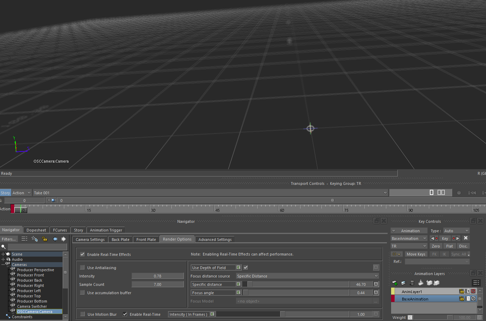
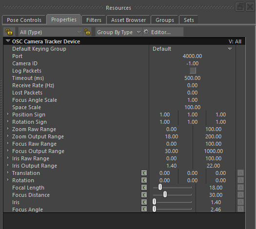

# mobu-device-camera-plugin

**OSC Camera Tracker Device** - a device plugin for Autodesk MotionBuilder that receives the OSC stream of the
**Camera Motion Studio** app (the phone app that is the camera tracker).

The device listens to the OSC stream (UDP) of Camera Motion Studio and drives a MotionBuilder camera in real time:
transform, focal length, focus distance and the depth of field cone (focus angle). It can record the incoming
poses as animation keys, runs the MotionBuilder transport from the app's buttons, and can send objects of the scene to
the phone as markers to aim at and hold focus on.

## OSC stream

The device accepts these messages and ignores everything else. A truncated or malformed datagram is rejected,
never read past its end.

| Address | Type tags | Content |
|---|---|---|
| `/livetracker/pose/ref` | `,iiiihiiis` + 12 `f` + 3 `i` | the camera message of the current app: version, camera id, stream session, output sequence, capture time, mode (world / relative to the Ref), Ref generation, follow, the Ref's marker key, the pose relative to the Ref (x, y, z, pan, tilt, roll), the world pose, zoom, focus, iris. Version 1 only |
| `/livetracker/pose` | `,iffffffiiih` | the former camera message, still read as a world pose: camera id, pan, tilt, roll (degrees), x, y, z (metres), zoom, focus, iris, capture time (ns, on the phone's clock) |
| `/livetracker/lens` | `,iiiiffffffff` | camera id, zoom / focus / iris calibrated flags, min and max of zoom (mm), focus (m), iris (f-number), sensor width and height (mm) |
| `/livetracker/diag` | `,ih` | sequence number, send time (unix ms) - used to count lost packets |
| `/livetracker/cmd` | `,iis` | camera id, button press counter, command text - the app's OSC buttons, see [Remote control](#remote-control) |
| `/livetracker/link` | `,iii` | what the phone says about the marker link, see [Markers](#markers) |
| `/livetracker/link/roles` | `,isssiii` | the marker roles in force on the phone's Live scene, see [Marker roles](#marker-roles) |
| `/livetracker/units` | `,sf` | the unit of the stream's positions (`m`, metres) and the phone's own Space scale, a gain already in the positions; the device turns the unit into the scene's centimetres itself |

Wire frame is X right, Y forward, Z up (right handed, "Default" axis mapping of Camera Motion Studio). It is converted to the
MotionBuilder frame of the app's FBX export: X right, Y up, Z back, centimetres. A move to the right in the app is +X, forward is
-Z, up is +Y, and the camera at the tracker's zero pose looks along -Z, so the live camera matches the FBX of the same take.
The rotation keeps the zero pose of the tracker as the zero rotation of the camera (pan, tilt, roll are the rotations about Y, Z, X,
no gimbal lock): the device gives the bound camera a **Pre Rotation** of (0, 90, 0), with Rotation Active on and the XYZ order,
which turns it to face -Z. Keep the app on the **Default** axis mapping: the device has no axis flips of its own, and the marker look-at
and the camera relative to the Ref need that mapping on the phone anyway. The positions arrive in metres (the stream
names its unit in `/livetracker/units`, and metres are assumed until it does) and the device turns them into the scene's centimetres
itself. `Space Scale` (1 by default) is only an extra multiplier on top of that, see [Device properties](#device-properties).

Lens channels that are calibrated in the app (`/livetracker/lens`) are taken as physical values. Channels that are
not calibrated are remapped from the raw encoder range to a range you set on the device (see the `... Raw Range` and
`... Output Range` properties below). The lens message is matched to the camera by its camera id, so two phones can
stream to one port.

### Smooth motion

Wi-Fi delivers the poses with a jitter. The device does not apply them on arrival: every pose carries the time its sensor
sample was taken (on the phone's own clock), and the device places the poses on that timeline. The app sends up to 120 poses per
second from a 30-60 Hz sensor: the repeats of a sample are dropped, a late packet is put in its place, and a recorded take gets
one key per real sensor sample, at the time the sample was taken, with no delay and no blending.

The live camera is drawn from that timeline in one of three ways (`Playback Mode`):

- **Auto** (default): the camera is shown a little behind the stream, by the late packets of the last 5 seconds (the 99th percentile of
  the excess delay) plus a part of a sample spacing, between `Playback Delay` (the lowest) and `Max Auto Delay`. Every frame is then
  between two real samples, nothing is guessed. The delay rises quickly (up to 20 ms per second) when the network gets worse and falls slowly
  (2 ms per second) when it is calm again. `Responsiveness` chooses how much of the jitter it covers: *Responsive* (the least delay,
  some frames are still extrapolated), *Balanced* (default) or *Smooth* (the most delay, no extrapolation).
- **Fixed delay**: `Playback Delay (ms)`. With 0 the newest sample is shown at once, pushed on by how late it arrived from the speed of the
  last two samples - the most responsive, but a guess that is off by the speed times the jitter (a few degrees in a fast turn on Wi-Fi).
  A delay of 30-40 ms avoids it.
- **Newest sample**: the newest sample as received, with no delay, no extrapolation and no blending. Every value is a real sample, but
  it is shown at the time it arrives, so the jitter of the network is seen as steps in the motion.

`Delay In Use (ms)` shows the delay of the live camera and `Jitter (ms)` the spread of the network delay the device sees. On a replay of a recorded Wi-Fi stream (60 Hz, 14-19 ms of jitter) Balanced showed 99 % of the frames by interpolation with
25 ms of added delay, where delay 0 was off by up to 4 degrees in a fast turn.

### Sensor size

The app sends the sensor (film back) it uses. With `Apply Sensor Size` on, the device sets the film back of the bound camera
to it (custom film back), so the focal length gives the same field of view as in the phone's 3D view.

## Usage

1. Install the plugin, then restart MotionBuilder:
   * **Installer** - run `Setup_TechStoryOSCCamera_MoBu.exe`, tick the MotionBuilder versions to install for
     (the plugin goes into `bin\x64\plugins` of each selected installation, administrator rights are needed), or
   * **Manually** - copy `device_oscCamera.dll` into a MotionBuilder plugins folder
     (e.g. `C:\Program Files\Autodesk\MotionBuilder 2025\bin\x64\plugins`).
2. In the Asset Browser go to **Templates > Devices** and drag **OSC Camera Tracker Device** into the scene.

   

3. Select the device in the Navigator (**Devices**). The **General** tab has the sampling settings. Set the
   **Sampling Rate** to the rate Camera Motion Studio streams at, so every incoming pose is picked up
   (the default 60 is only a starting value; MotionBuilder shows the rate the device gets as its samples/s). Keep the **Sampling Type** at `kFBHardwareTimestamp` (the default): every pose
   carries the time its sensor sample was taken, and a recorded take keys each sample at that time:

   

4. In the device **Communication** tab set the **UDP Port** to the *Target Port* of Camera Motion Studio. Make sure the phone/PC and
   MotionBuilder are on the same network and the firewall lets UDP in on that port.

   

5. Put the device **Online**. The status shows `Listening on UDP port ...`, then `Receiving data` once poses arrive,
   or `No data` when the stream is silent for longer than the **Timeout**.
6. Open the **Model binding**, create/pick a camera and bind it to the **Camera** template. The transform is driven by
   the device, the lens (focal length, focus distance, focus angle) is connected to the camera automatically.
   In the screenshot below the device is online (green), bound to the `OSCCamera:Reference` model and receiving data.
   The 60 samples/s shown there is the device sampling rate used for the demonstration, in practice it follows the rate
   of the streaming device.

   

7. Enable **Recording** on the device to key the incoming poses.

The camera lens is driven by the stream too: with **Use Depth of Field** on in the camera **Render Options**, the
**Specific distance** (focus distance) and the **Focus angle** follow the device.



The device also has an **Iris** (f-number) output that a camera does not have a property for. Use it in a relation
constraint, e.g. to drive a depth of field effect.

### Remote control

The OSC buttons of Camera Motion Studio (Pro, **Protocol = OSC**) drive the MotionBuilder transport. The device only has to
be online - the pose stream does not have to be running, so you can rewind and arm a take from the phone before streaming.

| Command | MotionBuilder |
|---|---|
| `play` | Play |
| `stop` | Stop (also ends a recording) |
| `record` | Record (ignored if already recording) |
| `goto_start` | Go to start |
| `goto_end` | Go to end |
| `step_forward` / `step_back` | Step one frame forward / back |

Every press is sent three times by the app; the device acts on the first copy only. A command that is not in the table
(a custom button of the app) does nothing except show in the `Last Command` property, which a script can watch.
The `Camera ID` filter applies to commands too: with `Camera ID` set, only buttons of the phone streaming that camera
id are accepted. Turn `Remote Control` off to ignore the commands. The transport is driven from the MotionBuilder main
thread; nothing happens while the transport is locked.

### Markers

The device can send objects of the MotionBuilder scene to the phone as **markers** (the phone's *Live scene*): shapes the
operator can aim at (the soft look-at) and hold the focus on (Mark). The positions are sent in the stream frame through
the inverse of the way the device places the camera, so a marker lands on the phone where the camera it drives would see it.

1. In the app turn on **Settings > Stream > Scene link > Accept a marker link** (it is off by default; the port is 4001).
2. In the device **Markers** tab select models in the scene and press **Add Selected Models**, then tick
   **Send markers to the phone**. The first time the phone asks the operator to **Allow** this computer.
3. Set up every marker in the table:

   | Column | |
   |---|---|
   | Model | the model of the scene (read only) |
   | Name on phone | the label shown on the phone, the model name by default |
   | On | the marker is shown |
   | Focus / Aim / Ref | what the phone does with the marker, see [Marker roles](#marker-roles): three switches, a marker may hold any combination of them. One marker per role: switching a role on takes it off the marker that had it, which keeps its other roles |
   | Shape | point, box, sphere or capsule |
   | Color | one of the eight colors of the phone |
   | Width / Depth / Height (m) | the size: a box uses all three, a sphere only the width (its diameter), a capsule the width (diameter) and the height. **Size From Model** fills them from the bounding box of the selected row |
   | Model origin | where the origin of the model is: at the base of the marker (feet) or in its centre |
   | Focus / aim at | the point the phone aims at and holds focus on: base, centre or top |

The list of models (the `Markers` property) and the table (kept in the `Marker Settings` property) are saved in the scene
with the device and come back when it is loaded. The models are found again by name if the list is reordered.

What is sent, in short (the wire is section 10 of the `OSC_PROTOCOL.md` of Camera Motion Studio; the plugin implements it in `src/osc_marker_link.h`):
* The key of a marker is the **model name** (at most 32 bytes, a number is added when two are the same), not the label, so the phone keeps
  a marker's Focus, Aim or Ref role while you rename its label in the table.
* The sizes go in metres, the positions in the unit of the pose stream (metres: the device divides by the same factor it multiplies the camera by), the heading is the
  heading of the model's X axis about the vertical, counter-clockwise from the stream's +X.
* The phone shows the **timeline position of MotionBuilder** (`LocalTime`) as the clock of its Live scene, so a recording made on the phone
  can be lined up with the take.
* The definitions go out when they change and once a second, the positions when something moves and at least twice a second;
  the phone calls the link quiet after 3 seconds of silence. It never needs an answer, so nothing blocks the scene.

The `Phone Link` property says where the link stands: `Waiting for the first pose` (the phone is found by its poses),
`Waiting for the phone to answer`, `The phone does not answer: is the stream running?` (the phone reports its link status only while it
streams OSC), `The phone's marker link is off`, `The phone is listening: allow this computer on the phone`, or `Phone linked, N markers`.

Notes
* The phone is found by the poses it streams: its address is the source of the poses, so the stream has to run
  (`Phone Address` shows it). The `Phone Link` property tells what the phone says: link off in the app, waiting to be allowed,
  or linked with N markers.
* At most 16 markers are sent. A marker turns about the vertical only: a tilted model is sent upright, with the heading of its X axis.
* The camera of the device itself cannot be a marker. The markers are placed relative to the **Reference** model of the device
  (the root the camera is bound under), so moving the Reference moves the markers with the camera.
* The phone needs its **Default** axis mapping for the look-at; the unit and `Space Scale` apply to the markers as they do to the camera.
* Turning the option off, stopping the device or an empty list tells the phone the link ends (its Live scene closes).

### Marker roles

The device can say which marker is which on the phone, the same way as the Blender add-on (section 10.10 of `OSC_PROTOCOL.md`):

| Role | On the phone |
|---|---|
| **Focus** | the focus follows the distance to the marker (Mark) |
| **Aim** | the soft look-at turns the camera toward the marker |
| **Ref** | the marker is the camera's parent, the camera moves with it: a reference offset, or a vehicle the camera rides on |

Switch the **Focus**, **Aim** and **Ref** of a marker on in the table. One marker may hold two or all three (the phone takes the
combinations since the app of 2026-11-01, an older app keeps Ref and drops the other two); each role is still on one marker only.
Under the status line of the **Markers** tab:

| Option | |
|---|---|
| Ref follows heading | what the Ref passes on to the camera: off - its position only (an offset, the default), on - its position and heading (a camera on a vehicle) |
| Set look-at % | the device sets how far the phone turns the camera toward the Aim marker; off (the default) - the operator chooses on the phone |
| Mirror the phone | when the operator picks a role on the phone, it is taken into the table too, so both ends agree (default on). Off: the device keeps its roles and only shows what the phone has |
| Send Roles to Phone | gives every role on the phone back to the ones of the table, also those the operator changed on the phone |

How the two ends agree:
* The phone follows the device's roles. The operator can still pick a role on the phone's Live scene: that one role is then the
  operator's until it is changed on the device (or **Send Roles to Phone** is pressed). The other roles keep following the device.
* The phone reports the roles in force about once a second while its Live scene shows. The line under the options says
  `The phone has these roles`, what the operator set there (`Phone: Ref = Cart (set on phone)`), or that the phone reports its roles
  only while its Live scene shows.
* A role just changed on the device is not undone by a report the phone sent before it saw the change: it waits until the phone
  takes it, at most 3 seconds.
* A combination the operator makes on the phone (`Focus = Car, Ref = Car`) is mirrored as it is: the marker gets the role beside the
  ones it has, so the device sends the same combination back and the phone keeps it.
* Scenes saved with one role per marker load with that role. A scene saved now still opens in an older plugin, with one role per marker
  (Ref, else Focus, else Aim).
* With no roles in the table (all off) the phone starts with none, and the operator picks them on the phone; a pick stays until
  that role is changed on the device. With **Mirror the phone** on, the pick shows up in the table.

### Camera relative to the Ref

When the phone has a Ref (a marker the camera rides on), it sends the camera **relative to that marker** as well as its world
pose. The device composes the two itself, with the Ref marker as it is in your scene now: `camera in the world = Ref * camera
relative to the Ref`. A Ref that is moved in MotionBuilder (a cart on a path, a character) therefore carries the live camera with
no round trip through the phone, instead of showing it where the Ref was a moment ago.

* The Ref is found by its **key**, the one the device sent the marker with: the Ref has to be one of the models of the table
  (give it the role **Ref**, or let the operator pick it on the phone with **Mirror the phone** on). The device reads its place
  from the model at the time of each frame.
* The Ref passes on its position (the middle of its base, a point itself), and with **Ref follows heading** its heading about the vertical
  too. Its scale and tilt are never passed on.
* The device falls back to the **world pose of the stream** when the phone sends the world pose (it has no Ref, or is easing or
  holding), when the Ref is not a marker of the table, or with `Reference-Local Camera` off. `Camera Source` (and the line under the
  options of the **Markers** tab) says which, so a camera that stands still because its Ref is missing is easy to see.
* The poses relative to one Ref are blended with each other only: across a change of the Ref, of its follow or of the mode the live
  camera stays at the earlier sample until the later one is due. A new stream session of the phone starts a new timeline, and a
  datagram that is not newer by the output sequence is dropped.
* **Recorded keys are always the world poses of the phone**, as in the other receivers: a take does not depend on where the Ref is
  when it is played back. The live camera and a take can therefore differ when the Ref was moved late.
* The composition assumes the **Default** axis mapping, like the phone's look-at (with another mapping the phone sends only the world pose).

### Device properties

The properties are in the **Properties** tab of the Resources panel while the device is selected:



| Property | Description |
|---|---|
| `Port` | UDP port to listen to (default 4000) |
| `Camera ID` | accept only this camera id from the stream, -1 - any |
| `Timeout (ms)` | time without a pose after which the stream is reported as `No data` |
| `Remote Control` | act on the transport commands of the app's OSC buttons (default on) |
| `Last Command` | the last command received from the app, also a custom one, read only |
| `Playback Mode` | how the live camera is drawn: 0 *Auto* (default, the delay follows the jitter of the network), 1 *Fixed delay*, 2 *Newest sample* |
| `Playback Delay (ms)` | Fixed: how far behind the stream the live camera is shown, to interpolate between samples (0 - the newest sample, extrapolated); Auto: the lowest delay (default 0) |
| `Max Auto Delay (ms)` | the most delay Auto may add (default 60) |
| `Responsiveness` | how much of the jitter Auto covers: 0 *Responsive*, 1 *Balanced* (default), 2 *Smooth* |
| `Apply Sensor Size` | set the film back of the camera to the sensor of the app (default on) |
| `Marker Link` | send the models of the `Markers` list to the phone (default off) |
| `Link Port` | the marker link port of the phone (default 4001) |
| `Markers` | the models sent as markers; add them in the **Markers** tab or drag them here |
| `Marker Settings` | the table of the **Markers** tab, saved with the scene (hidden) |
| `Ref Follows Heading` | the Ref marker passes on its heading too (a camera on a vehicle); off - only its position (default off) |
| `Reference-Local Camera` | place the live camera by the Ref marker where it is in the scene now (default on), see [Camera relative to the Ref](#camera-relative-to-the-ref) |
| `Camera Source` | which pose the live camera follows and why, read only |
| `Set Look-at` | the device sets the look-at strength; off - the operator chooses it on the phone (default off) |
| `Look-at (%)` | how far the phone turns the camera toward the Aim marker, 0 to 100 (default 50) |
| `Mirror the Phone` | take the roles the operator picks on the phone into the table (default on) |
| `Phone Roles` | what the phone says about the roles, read only |
| `Log Packets` | trace the received messages into the MotionBuilder log |
| `Jitter (ms)` | spread of the network delay seen over the last seconds (largest - smallest), read only |
| `Delay In Use (ms)` | the delay the live camera is drawn with now, read only |
| `Lost Packets` | frames missing in the stream, counted from the diagnostics sequence (turn *Stream diagnostics* on in the app), read only |
| `Sensor Size (mm)` | the sensor of the app, read only |
| `Phone Address` | where the poses come from, read only |
| `Phone Link` | what the phone says about the marker link, read only |
| `Stream Units` | the unit the stream says its positions are in (`m` until it says so: "m (assumed)") and the phone's own Space scale when it is not 1, read only. The device turns this unit into the scene's centimetres (metres x 100) itself |
| `Space Scale` | an extra multiplier on the position, after the stream's unit is turned into centimetres: 1 (the default). The phone's own Space scale is a gain too, so set the gain in one place |
| `Focus Angle Scale` | multiplier of the focus angle computed from the iris, focal length and focus distance |
| `Zoom / Focus / Iris Raw Range` | raw encoder range of a channel that is not calibrated in the app |
| `Zoom / Focus / Iris Output Range` | what that raw range is remapped to: focal length (mm), focus distance (cm), f-number |

The port is bound when the device goes online, so restart the device after changing it.

## Build

Requirements
* Windows, Visual Studio 2022 (MSVC)
* CMake 3.19+
* Autodesk MotionBuilder with its OpenReality SDK (the SDK is installed together with MotionBuilder)

```bat
cmake -S . -B build -G "Visual Studio 17 2022" -A x64
cmake --build build --config RelWithDebInfo --target device_oscCamera
```

The plugin is `build\RelWithDebInfo\device_oscCamera.dll`.

CMake options

| Option | Default | Description |
|---|---|---|
| `MOBU_VERSION` | `2025` | MotionBuilder version to build against, must match the `MOBU_ROOT` installation |
| `MOBU_ROOT` | `C:/Program Files/Autodesk/MotionBuilder <MOBU_VERSION>` | MotionBuilder installation folder |
| `OPENREALITY_ROOT` | `<MOBU_ROOT>/OpenRealitySDK` | OpenReality SDK folder (headers and import libraries) |
| `COPY_TO_PLUGINS` | `OFF` | copy the built dll into `MOBU_PLUGINS_DIR` after every build |
| `MOBU_PLUGINS_DIR` | `<MOBU_ROOT>/bin/x64/plugins` | destination of `COPY_TO_PLUGINS` (a folder under Program Files needs administrator rights) |

For example, to build for MotionBuilder 2024 and copy the dll into a custom plugins folder:

```bat
cmake -S . -B build -G "Visual Studio 17 2022" -A x64 -DMOBU_VERSION=2024 -DCOPY_TO_PLUGINS=ON -DMOBU_PLUGINS_DIR=D:/MyPlugins
```

## Tests

The OSC decoder, the camera math, the timeline and the marker link (`src/osc_camera_decoder.h`, `osc_camera_math.h`,
`osc_camera_timeline.h`, `osc_marker_link.h`) are header-only and do not depend on the SDK, so they are tested standalone.
The tests are not part of the default build:

```bat
cmake --build build --config RelWithDebInfo --target device_oscCamera_decoder_test device_oscCamera_math_test device_oscCamera_timeline_test device_oscCamera_marker_test device_oscCamera_reference_test
build\RelWithDebInfo\device_oscCamera_decoder_test.exe
build\RelWithDebInfo\device_oscCamera_math_test.exe
build\RelWithDebInfo\device_oscCamera_timeline_test.exe
build\RelWithDebInfo\device_oscCamera_marker_test.exe
build\RelWithDebInfo\device_oscCamera_reference_test.exe
```

The marker link tests check the golden bytes of `OSC_PROTOCOL.md` section 10.7, the same ones the app and the Blender add-on check.
The decoder and reference tests use the wire bytes and the composition numbers of the app's shared fixtures
(`transform_fixtures.json`, `wire_ref_pose` and `compose`).

## Source layout

| File | Content |
|---|---|
| `src/device_osccamera.cxx` | library registration |
| `src/device_osccamera_device.*` | the device: properties, animation nodes, evaluation, recording, stream status |
| `src/device_osccamera_hardware.*` | UDP receiving (through `FBTCPIP`, no platform sockets) |
| `src/device_osccamera_layout.*` | the device UI |
| `src/osc_camera_decoder.h` | strict OSC decoder |
| `src/osc_camera_math.h` | conversion to the MotionBuilder frame and units, lens and focus angle, blending of two samples |
| `src/osc_camera_timeline.h` | the poses on the timeline of the phone: ordering, repeats, clock offset, interpolation |
| `src/osc_marker_link.h` | the marker link: message encoders, what to send when, the table settings and their saved text, placement, the roles kept in step with the phone |
| `tests/` | standalone tests |

## License

MIT, see [LICENSE](LICENSE).
